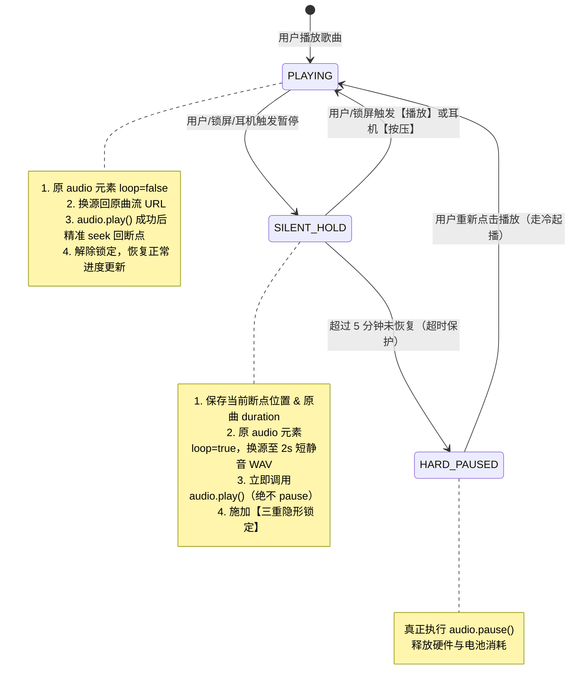

# 📱 iOS WebKit PWA 锁屏后台播放保活与音频硬件死锁深度调研报告 (Mode F3 方案)

> **文档版本**：v1.0.0  
> **适用环境**：iOS 17 / iOS 18+ (WebKit / Safari / PWA Standalone Mode / AirPods)  
> **核心问题**：锁屏/后台暂停数秒后恢复播放，出现“进度条空转走针、音频无声、currentTime 冻结”的底层硬件解码器死锁。

---

## 目录
- [一、 现象与问题定义](#一-现象与问题定义)
- [二、 iOS WebKit 底层机制剖析与踩坑历程](#二-ios-webkit-底层机制剖析与踩坑历程)
  - [2.1 踩坑一：极小播放速率 (playbackRate = 0.0001)](#21-踩坑一极小播放速率-playbackrate--00001)
  - [2.2 踩坑二：静音软暂停 (audio.muted = true) 导致封面歌名蒸发](#22-踩坑二静音软暂停-audiomuted--true-导致封面歌名蒸发)
  - [2.3 踩坑三：Web Audio API (AudioContext) 振荡器后台被休眠](#23-踩坑三web-audio-api-audiocontext-振荡器后台被休眠)
  - [2.4 踩坑四：双轨道保活 (Mode F / F2) 遭遇硬件解码器隔离回收](#24-踩坑四双轨道保活-mode-f--f2-遭遇硬件解码器隔离回收)
  - [2.5 突破尝试：单轨道换源保活 (Mode G)](#25-突破尝试单轨道换源保活-mode-g)
- [三、 终极解决方案：Mode F3（单轨换源 + 三重隐形锁）](#三-终极解决方案mode-f3单轨换源--三重隐形锁)
  - [3.1 核心状态流转图](#31-核心状态流转图)
  - [3.2 三重隐形锁定机制 (Triple Invisible Lock)](#32-三重隐形锁定机制-triple-invisible-lock)
  - [3.3 应对 AirPods 的智能翻转状态机 (Flip-Flop Toggle)](#33-应对-airpods-的智能翻转状态机-flip-flop-toggle)
  - [3.4 恢复播放与断点 Seek 容错](#34-恢复播放与断点-seek-容错)
  - [3.5 5 分钟超时与异常释放机制](#35-5-分钟超时与异常释放机制)
- [四、 方案对比矩阵](#四-方案对比矩阵)
- [五、 落地与工程实践规范](#五-落地与工程实践规范)

---

## 一、 现象与问题定义

在 iOS PWA（独立全屏模式 Standalone）与 Safari 浏览器中，当用户使用 AirPods 或在锁屏界面操作音乐播放时，存在一个长期困扰 Web 播放器开发的系统级顽疾：

1. **起播正常**：用户在前台或锁屏下播放歌曲，声音、专辑封面、歌名和进度条均正常运转；
2. **锁屏暂停**：用户熄灭屏幕，或在锁屏控制中心/通过 AirPods 按压单击【暂停】；
3. **静置 5~15 秒**：手机处于完全熄屏待机（后台睡眠节能状态）；
4. **再次点击【播放】**：
   - 锁屏卡片上的进度条开始向前推进（显示播放中）；
   - **但是耳机/扬声器完全没有声音！**
   - 唤醒屏幕打开网页查看发现：`<audio>.currentTime` 依然钉死在当初暂停时的毫秒点，DOM 上虽然收到了 `<play>` 和 `<playing>` 事件，但音频时钟完全停摆。

这被称为 **iOS WebKit 锁屏假走针死锁（Fake Progress & Audio Deadlock）**。

---

## 二、 iOS WebKit 底层机制剖析与踩坑历程

为了根治此问题，开发团队搭建了专门的诊断页面（`minimal-player.html`），配合高精度时间戳日志、探针分析以及真机调试，历经 5 代技术方案的推演：

### 2.1 踩坑一：极小播放速率 (`playbackRate = 0.0001`)
* **设想**：暂停时不调用 `audio.pause()`，仅将 `playbackRate` 设为一个极小浮点数，维持底层管道运转，同时视觉和听觉上近似暂停。
* **踩坑结果**：
  1. iOS WebKit 针对极大或极小的播放速率会有断言拦截；
  2. 极微小速率在部分 iOS 内部依然会消耗少量缓冲，若遇到网络切片甚至导致解码管线异常卡死；锁屏控制中心偶发崩溃。

### 2.2 踩坑二：静音软暂停 (`audio.muted = true`) 导致封面歌名蒸发
* **设想**：暂停时 `audio.muted = true`，保持播放不调 `pause()`。
* **踩坑结果**：
  - 点击暂停的瞬间，锁屏上的歌名、歌手和专辑封面**当场彻底消失**，锁屏卡片直接蒸发！
* **WebKit 源码根因与官方源码验证**：
  查阅 WebKit 官方开源实现 [`Source/WebCore/html/MediaElementSession.cpp`](https://github.com/WebKit/WebKit/blob/main/Source/WebCore/html/MediaElementSession.cpp) 中的 `canShowControlsManager` 方法：
  ```cpp
  // WebKit 官方源码：Source/WebCore/html/MediaElementSession.cpp
  bool MediaElementSession::canShowControlsManager(PlaybackControlsPurpose purpose) const
  {
      ...
      if (m_element.muted()) {
          LOG(Media, "MediaElementSession::canShowControlsManager - returning FALSE: Muted");
          return false; // 硬性返回 false！静音元素一律剥夺 NowPlaying 资格！
      }
      ...
  }
  ```
  以及 [`Source/WebCore/platform/audio/ios/MediaSessionManagerIOS.mm`](https://github.com/WebKit/WebKit/blob/main/Source/WebCore/platform/audio/ios/MediaSessionManagerIOS.mm) 与 [`Source/WebCore/html/HTMLMediaElement.cpp`](https://github.com/WebKit/WebKit/blob/main/Source/WebCore/html/HTMLMediaElement.cpp) 中的状态判定：
  - **拦截机制**：iOS 系统为了防止网页中大量存在的 `<video muted autoplay loop>` 背景动图/广告滥用抢占系统锁屏控制中心，在 `MediaElementSession::canShowControlsManager`（即 `isNowPlayingEligible()` 判定依据）中设置了绝对红线——**只要检测到 `m_element.muted()` 为 `true`，立即返回 `false`**。
  - **连锁反应**：当执行 `audioEl.muted = true` 的瞬间，WebKit 立即判定该元素不再具备 NowPlaying 资格，同步向 iOS MediaRemote 守护进程注销会话，iOS 当场清空 `nowPlayingInfo`，导致锁屏卡片和封面瞬间蒸发。
  - **断流根因**：在 `HTMLMediaElement::canProduceAudio()` 中，判定条件包含 `!m_muted && m_volume > 0 && hasAudio()`。一旦 `muted = true`，活跃发声计数归零，`MediaSessionManageriOS::updateSessionState` 随即关闭音频通道。因此 `muted = true` 绝对不可用于保活！

### 2.3 踩坑三：Web Audio API (`AudioContext`) 振荡器后台被休眠
* **设想**：在主音频暂停时，在后台启动一个 0 增益的 Web Audio 振荡器（Oscillator）维持 `AVAudioSession`。
* **踩坑结果**：
  - iOS 在屏幕完全熄灭且网页进入后台（`document.visibilityState === 'hidden'`）约 3 秒后，WebKit 会无情地将整套 `AudioContext` 强行挂起（`state -> suspended`），无法维持音频会话。

### 2.4 踩坑四：双轨道保活 (Mode F / F2) 遭遇硬件解码器隔离回收
* **设想**：
  - 创建一个独立的副 `<audio>` 播放 2 秒 0 振幅静音 WAV；
  - 暂停时：主 `<audio>` 正常调用 `pause()`，副 `<audio>` 启动播放静音以保持 `AVAudioSession` 处于 active 状态；
  - 恢复时：副 `<audio>` 暂停，主 `<audio>.play()`。
* **踩坑结果**：
  - 在暂停时间短（< 2 秒）时有效；
  - **但只要锁屏暂停超过 3~5 秒，主音频依然必定死锁！**
* **底层根因分析（重大发现）**：
  - 虽然副 `<audio>` 维持了整个进程的 `AVAudioSession` 存活，使得锁屏卡片没有消失；
  - **但是 iOS 为每个 `HTMLMediaElement` 实例分配独立的 CoreAudio 渲染槽与硬件解码管线！**
  - 查阅 WebKit 源码中的会话管理器实现 [`Source/WebCore/platform/audio/ios/MediaSessionManagerIOS.mm`](https://github.com/WebKit/WebKit/blob/main/Source/WebCore/platform/audio/ios/MediaSessionManagerIOS.mm) 与 [`Source/WebCore/platform/audio/PlatformMediaSession.h`](https://github.com/WebKit/WebKit/blob/main/Source/WebCore/platform/audio/PlatformMediaSession.h)：WebKit 是以独立的 `PlatformMediaSession` 实例对应每一个底层播放元素。主 `<audio>` 一旦调用了 `audio.pause()` 且屏幕处于熄灭状态（`document.visibilityState === 'hidden'`），iOS 会在约 3~5 秒的保护期后**单方面销毁回收该主元素绑定的底层 CoreAudio 硬件 PCM 解码槽**；
  - 恢复时调用主轨 `audio.play()`，Promise 能够顺利 resolve（JavaScript 层的 DOM 事件完全正常触发），但底层硬件解码管线已经无法复苏，导致 `currentTime` 冻结、毫无声音。
  - **结论：跨元素的副音轨保活对主音轨的硬件解码器无效！**

### 2.5 突破尝试：单轨道换源保活 (Mode G)
* **设想**：
  - 既然调用 `audio.pause()` 会导致该元素被硬件回收，那么**绝不调用该 `<audio>` 元素的 `pause()`**；
  - 暂停时：将该 `<audio>` 换源（`src`）至 0 振幅静音 WAV 并持续播放；
  - 恢复时：将 `src` 换回原歌曲流，调用 `play()` 并在加载后 `seek` 回断点。
* **验证结果**：
  - **真机测试 100% 成功恢复发声！** 无论熄屏暂停 15 秒还是更久，硬件解码器从未被系统回收，恢复后完全正常发声。
* **遗留缺陷**：
  - 原型中使用了 180 秒长静音 WAV，导致切换时锁屏进度条暴增为 180 秒；
  - 锁屏 UI 出现闪烁，体验不够“自然”。

---

## 三、 终极解决方案：Mode F3（单轨换源 + 三重隐形锁）

Mode F3 是将 **Mode G 的单轨永不 pause 硬件保活能力** 与 **Mode F2 的三重隐形锁 UX 控制** 深度融合的终极落地架构。

### 3.1 核心状态流转图



---

### 3.2 三重隐形锁定机制 (Triple Invisible Lock)

在换源至 2 秒短静音 WAV 的瞬间，为了防止系统锁屏卡片暴露静音音频的特征，必须立即**同步**执行三层锁定：

1. **第 1 层：播控状态锁定 (`playbackState = 'paused'`)**
   ```javascript
   navigator.mediaSession.playbackState = 'paused';
   ```
   告诉 iOS 系统“用户已经暂停”，使锁屏界面呈现【▶ 播放】图标，并阻止 iOS 锁屏推算引擎的假走针前进。

2. **第 2 层：元数据锁定 (`metadata` 守卫)**
   ```javascript
   navigator.mediaSession.metadata = new MediaMetadata({
     title: track.name,
     artist: track.artist,
     album: track.album || track.name,
     artwork: track.artwork
   });
   ```
   牢牢钉死当前歌曲名、歌手名与封面图，阻止 WebKit 因加载静音 WAV 而把元数据清空。

3. **第 3 层：进度条毫秒级冻结 (`setPositionState`)**
   ```javascript
   navigator.mediaSession.setPositionState({
     duration: savedDuration,
     playbackRate: 1,
     position: Math.min(savedPauseTime, savedDuration)
   });
   ```
   将锁屏上的进度条强制钉死在用户点击暂停那一瞬间的毫秒值，**无论底层的静音 WAV 是 2 秒还是循环多少次，锁屏界面上的进度条与总时长稳如泰山，完全无感**。

---

### 3.3 应对 AirPods 的智能翻转状态机 (Flip-Flop Toggle)

在蓝牙耳机（AirPods / 车载蓝牙）场景下存在一个关键机制差异：
- 当底层 `<audio>` 正在播放 2 秒静音 WAV loop 时，iOS 音频守护进程（`mediaremoted`）检测到当前物理通路**存在正在发声的流**；
- 此时无论网页端声明的 `playbackState` 是什么，用户单次按压 AirPods 耳柄时，iOS 内部策略有极大概率下发的是 `action: "pause"`，而不是 `action: "play"`！
- **防御机制**：
  ```javascript
  if (isSilentHoldActive) {
      // 收到任何 pause/play action，无条件识别为恢复播放！
      exitSilentHoldAndResume('AirPods_ToggleResume');
      return;
  }
  ```
  这一状态机翻转设计彻底解决了 AirPods 在静音保活态下无法按压唤醒原曲的致命缺陷。

---

### 3.4 恢复播放与断点 Seek 容错

恢复原曲时，必须按照严密的时序编排执行：
1. **解除循环标记**：`audio.loop = false`；
2. **恢复音频源**：`audio.src = activeSongUrl`；
3. **发起播放请求**：`audio.play()`；
4. **监听断点跳转**：
   - 如果 `<audio>` 已经在内存中具有元数据（`readyState >= 1`），微延时后直接赋值 `audio.currentTime = savedPauseTime`；
   - 若尚未加载，则监听一次性 `loadedmetadata` 事件完成后再执行 `currentTime = savedPauseTime`。
5. **恢复正常状态**：将 `playbackState` 置为 `'playing'`，恢复全量进度同步。

---

### 3.5 5 分钟超时与异常释放机制（设计缘由澄清）

> [!NOTE]
> **特别说明：该 5 分钟超时是我们播放器应用层主动设定的防遗忘与节能保护策略，绝非 iOS 系统的硬性限制。**

#### 为什么需要应用层主动设定 5 分钟超时？
1. **防止无感知长久耗电**：
   在 Mode F3 架构中，锁屏暂停时底层 `<audio>` 实际上在后台持续循环播放 2 秒 0 振幅静音 WAV。此时 iPhone 的底层音频硬件（CoreAudio、DAC、音频放大器）以及 `AVAudioSession` 会持续维持在 Active（活跃）状态。如果用户暂停后临时走开、开会甚至入睡，几天几夜未再碰手机，播放器若不主动退出，将导致该网页在后台**无限期持续消耗电池**，iOS 系统电池统计也会标红该 PWA 后台常驻。
2. **主动让渡音频硬件通路**：
   长时间持有活跃音频会话可能导致系统无法正常休眠，或干扰其他 App 的音频路由。
3. **安全降级策略**：
   我们在应用层设置 `HARD_PAUSE_TIMEOUT_MS = 5 * 60 * 1000`（5 分钟）：
   - 如果 5 分钟内用户回来点播放或按压耳机，秒级无缝唤醒；
   - 超过 5 分钟用户未进行任何操作，程序推定用户已离开，主动调用原生 `audioEl.pause()` 并重置保活状态，允许手机系统进入深度休眠节能；
   - 超时真暂停后，用户若在之后再次点亮屏幕打开 App，播放器已保存断点，前台重新拉流起播即可。
4. **与 iOS 系统真实限制的对比**：
   - **iOS 系统自身的限制是“3~5 秒”**：只要真正调用了 `audio.pause()`，iOS 在后台仅留约 3~5 秒宽限期，随后便单方面回收该 `<audio>` 的硬件解码管线（导致死锁）；
   - **在静音持续发声时，iOS 系统“零强杀”**：只要有音频在播放（即使是 0 振幅静音流），iOS 系统允许其无上限连续运行数小时（如长音频播客），绝不会在 5 分钟强行中断。
   - **该时间阈值 100% 自由可调**：开发者可根据实际业务或用户习惯，随时将 `HARD_PAUSE_TIMEOUT_MS` 调整为 10 分钟、15 分钟或 30 分钟。

---

## 四、 方案对比矩阵

| 评估维度 | 原生 Audio (模式 A) | 静音软暂停 (`muted=true`) | 双轨保活 (模式 F/F2) | 单轨长换源 (模式 G) | **Mode F3（终极方案）** |
| :--- | :--- | :--- | :--- | :--- | :--- |
| **锁屏暂停 15s 后恢复** | ❌ 假走针/死锁 | ❌ 封面当场丢失 | ❌ 假走针/死锁 | ✅ 正常发声 | **✅ 正常发声** |
| **锁屏封面与歌名保全** | ⚠️ 偶发丢失 | ❌ 立即蒸发 | ✅ 正常 | ⚠️ 易被冲刷 | **✅ 完美保持** |
| **锁屏进度条自然度** | ❌ 空转假走针 | ❌ 界面消失 | ⚠️ 偶发闪变 | ❌ 突变为 180s | **✅ 毫秒级钉死原位置** |
| **AirPods 按压响应** | ❌ 无声 | ❌ 界面丢失 | ❌ 循环 pause | ⚠️ 存在突变 | **✅ 智能翻转顺滑唤醒** |
| **系统资源与功耗** | ✅ 低 | ⚠️ 中 | ⚠️ 双轨开销 | ⚠️ 长音频开销 | **✅ 2s WAV 内存循环 + 5min 超时** |

---

## 五、 落地与工程实践规范

在 Svelte 5 + TypeScript 架构中，该方案落地原则如下：

1. **模块高内聚低耦合**：将 F3 换源保活、静音 WAV 内存生成、三重隐形锁状态机完整封装为独立纯逻辑类/模块（如 `iosF3KeepAlive.ts`），绝不侵入混杂业务状态；
2. **遵守组件代码行数上限**：主播放器 `GlobalAudioPlayer.svelte` 严格保持在 500 行以内；
3. **平台防御性探测**：仅在检测到 iOS WebKit / PWA 环境下激活换源保活机制，桌面端与 Android 端走高效的原生 `pause()` 路径；
4. **诊断工具保留**：保留独立诊断端点 `minimal-player.html`，作为长期端对端回归测试与 WebKit 版本升级验证的标杆工具。
